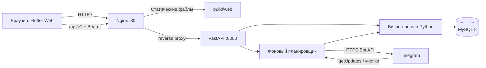

# Ритм — регулярные платежи команды

Веб-приложение для учёта аренды, подписок и других ежемесячных расходов.
Команда видит сроки и просрочки, отмечает оплату, а Telegram-бот напоминает о
приближающемся платеже. История сохраняется при прекращении регулярного платежа.

## Открыть проект

- **Сайт:** [http://94.228.173.229/](http://94.228.173.229/)
- **Swagger API:** [http://94.228.173.229/api/v1/docs](http://94.228.173.229/api/v1/docs)
- **Проверка API и базы:** [health](http://94.228.173.229/api/v1/health)
- **Telegram:** [@Invoice_keeperbot](https://t.me/Invoice_keeperbot)
- **Клиент:** [tigran14mar-arch/112233](https://github.com/tigran14mar-arch/112233)
- **Сервер:** [invoice-keeper-backend](https://github.com/tigran14mar-arch/invoice-keeper-backend)

Сайт открывается в браузере телефона, планшета или компьютера без установки
Flutter. Для работы нужен интернет и учётная запись, выданная администратором.
Логины, пароли, токен бота и SSH-доступ в README не публикуются.

## Экзаменатору: что смотреть

1. Открыть сайт и войти под выданной учётной записью.
2. На главной посмотреть календарь, ближайшие платежи, просрочки и итоги по валютам.
3. Администратором добавить регулярный платёж с ближайшим сроком.
4. В привязанной Telegram-группе проверить напоминание.
5. Отметить оплату в интерфейсе или кнопкой бота; обновить страницу и проверить состояние.
6. Открыть историю: оплаченный период сохраняется отдельно от будущих платежей.
7. Войти обычным пользователем и сравнить доступные действия с администратором.

Подробный план защиты: [docs/DEMO.md](docs/DEMO.md).
Карта модулей и потоков данных: [docs/ARCHITECTURE.md](docs/ARCHITECTURE.md).

## Что реализовано

| Возможность | Где проверять |
|---|---|
| Вход и сохранение сессии | Экран входа, профиль |
| Календарь, выбор месяца и дня | Главная |
| Сводка расходов и просрочек | Главная, платежи |
| Регулярные платежи и периоды оплаты | Раздел платежей |
| Создание, редактирование, прекращение регулярного платежа | Под администратором |
| Отметка оплаты и исправление фактической даты | Карточка периода |
| История оплаченных периодов | История |
| Управление пользователями | Профиль администратора |
| Напоминания и кнопка «Оплачено» | Привязанная Telegram-группа |
| Разные роли и серверная проверка прав | API: 401 без сессии, 403 без нужной роли |
| Адаптация к ширине экрана | Мобильный экран и настольная оболочка |

Суммы RUB, USD и EUR считаются отдельно: валютной конвертации нет.
Сроки и просрочки рассчитывает сервер и MySQL, а не часы устройства пользователя.

## Архитектура



Клиент и API доступны с одного адреса. Nginx отдаёт собранный Flutter и
проксирует `/api/` в FastAPI. Браузер не подключается к MySQL и не получает
токен Telegram. API и база запущены в Docker, сайт обслуживает Nginx хоста.

## Структура этого репозитория

| Файл/каталог | Ответственность |
|---|---|
| `lib/main.dart` | Точка входа, HTTP-клиент, модели главной, `RitmController`, календарь, навигация и тема |
| `lib/app_config.dart` | Единый адрес API: origin сайта для Web или `API_URL` при сборке |
| `lib/reg.dart` | Форма входа и `RitmSession`: токен, профиль, восстановление сессии |
| `lib/pay.dart` | Модели регулярных платежей, запросы к API и экран управления платежами |
| `lib/history.dart` | Модели, репозитории и экран истории оплат |
| `lib/profile.dart` | Профиль, роль, управление пользователями, выход |
| `web/` | HTML-вход, manifest и браузерные иконки |
| `test/widget_test.dart` | Проверки экрана входа и поведения сессии |
| `deploy/nginx.conf` | Раздача сайта, SPA fallback и проксирование API |
| `docs/` | Архитектура, демонстрация и проверка проекта |
| `pubspec.yaml`, `pubspec.lock` | Требования SDK и версии зависимостей |

`android/`, `ios/`, `linux/`, `macos/`, `windows/` — платформенные оболочки
Flutter. В этой поставке собирается и проверяется **Web**, а не установочные
пакеты для всех платформ.

## Запуск разработчиком

Нужен Flutter stable с Dart, удовлетворяющим ограничению `^3.13.5` в pubspec.

```bash
flutter --version
flutter pub get
flutter run -d chrome --dart-define=API_URL=http://94.228.173.229:8000
```

Без `API_URL` Web-клиент обращается к адресу текущего сайта. При `flutter run`
сервер разработки не проксирует `/api/`, поэтому для него явно задаётся API_URL.
Для native-сборок предусмотрен адрес сервера по умолчанию; его также можно
переопределить через `--dart-define=API_URL=...`.

## Сборка и размещение

```bash
flutter pub get
flutter test
flutter analyze
flutter build web --release --no-web-resources-cdn
```

Содержимое `build/web/` — готовый статический сайт. CanvasKit включён в сборку,
поэтому браузеру не нужно скачивать движок с отдельного CDN. Публикуйте весь
каталог, включая `assets/` и `canvaskit/`, а не один `index.html`.
[Официальная инструкция Flutter](https://docs.flutter.dev/deployment/web).

На текущем сервере версии находятся в `/var/www/ritm/releases/`, а симлинк
`/var/www/ritm/current` указывает на активную версию. Перед заменой Nginx
сохраняется резервная копия конфига. После установки `deploy/nginx.conf`:

```bash
nginx -t
systemctl reload nginx
curl -f http://127.0.0.1/api/v1/health
```

Обновление фронтенда не требует перезапуска бота или MySQL. Для отката
переключите `current` на предыдущий каталог релиза.

Бэкенд размещён отдельно: `/root/invoice-keeper-backend`. Его инструкции,
миграции, Docker Compose и тесты находятся в серверном репозитории.

## Сессия и доступ

Пользователь входит через `/api/v1/auth/login`, получает токен сессии,
который отправляется в `Authorization: Bearer ...`. Токен и профиль сохраняются
на устройстве для восстановления вкладки; пароль на диск не записывается.
Автоматического входа с зашитым администраторским паролем нет.
Если сессия истекла после перезапуска браузера, потребуется повторный вход.
Окончательное решение о правах принимает API, даже если пользователь изменит клиент.

## Границы текущей демонстрации

- Публичный адрес пока использует HTTP. Для постоянной эксплуатации нужны
  домен/HTTPS и пересмотр политики хранения сессии. Не используйте демонстрацию
  для чувствительных реальных платёжных данных.
- Учёт и напоминания не переводят деньги и не интегрированы с банком.
- Обновление данных происходит при загрузке/действиях/обновлении экрана;
  push-синхронизации интерфейса через WebSocket нет.
- Планировщик и Telegram polling работают внутри одного экземпляра API.
  Несколько экземпляров с одним токеном бота одновременно запускать нельзя.
- `/link` без одноразового кода предназначен только для локального тестового
  режима; на сервере он отключён. Группа `keeper` уже привязана.
- Реальные секреты, когда-либо попавшие в историю репозиториев, необходимо
  перевыпустить. Удаление из последнего коммита не очищает историю.

Результаты проверки и воспроизводимые команды: [docs/VERIFICATION.md](docs/VERIFICATION.md).

## Снимок опубликованного сайта


