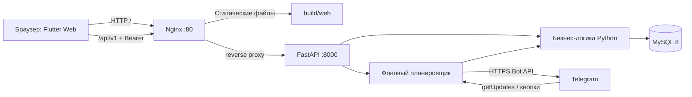

[README.md](https://github.com/user-attachments/files/33915742/README.md)
# Ритм — регулярные платежи команды

Веб-приложение для учёта аренды, подписок и других ежемесячных расходов.
Команда видит сроки и просрочки, отмечает оплату, а Telegram-бот напоминает о
приближающемся платеже. История сохраняется при прекращении регулярного платежа.

## Открыть проект

- **Сайт:** [http://94.228.173.229/](http://94.228.173.229/)
- **Swagger API:** [http://94.228.173.229/api/v1/docs](http://94.228.173.229/api/v1/docs)
- **Проверка API и базы:** [health](http://94.228.173.229/api/v1/health)
- **Telegram:** [@Invoice_keeperbot](https://t.me/Invoice_keeperbot)
- **Клиент:** [tigran14mar-arch/112233](https://github.com/tigran14mar-arch/112233)
- **Сервер:** [invoice-keeper-backend](https://github.com/tigran14mar-arch/invoice-keeper-backend)

Сайт открывается в браузере телефона, планшета или компьютера без установки
Flutter. Для работы нужен интернет и учётная запись, выданная администратором.
Логины, пароли, токен бота и SSH-доступ в README не публикуются.

## Экзаменатору: что смотреть
(в приложение можно зайти под админ аккаунтом: login: admin, password: 13254768, либо под пользовательским: login: hasbik, password: qwerty123)
1. Открыть сайт и войти под выданной учётной записью.
2. На главной посмотреть календарь, ближайшие платежи, просрочки и итоги по валютам.
3. Администратором добавить регулярный платёж с ближайшим сроком.
4. В привязанной Telegram-группе проверить напоминание.
5. Отметить оплату в интерфейсе или кнопкой бота; обновить страницу и проверить состояние.
6. Открыть историю: оплаченный период сохраняется отдельно от будущих платежей.
7. Войти обычным пользователем и сравнить доступные действия с администратором.

Подробный план защиты: [docs/DEMO.md](docs/DEMO.md).
Карта модулей и потоков данных: [docs/ARCHITECTURE.md](docs/ARCHITECTURE.md).

## Что реализовано

| Возможность | Где проверять |
|---|---|
| Вход и сохранение сессии | Экран входа, профиль |
| Календарь, выбор месяца и дня | Главная |
| Сводка расходов и просрочек | Главная, платежи |
| Регулярные платежи и периоды оплаты | Раздел платежей |
| Создание, редактирование, прекращение регулярного платежа | Под администратором |
| Отметка оплаты и исправление фактической даты | Карточка периода |
| История оплаченных периодов | История |
| Управление пользователями | Профиль администратора |
| Напоминания и кнопка «Оплачено» | Привязанная Telegram-группа |
| Разные роли и серверная проверка прав | API: 401 без сессии, 403 без нужной роли |
| Адаптация к ширине экрана | Мобильный экран и настольная оболочка |

Суммы RUB, USD и EUR считаются отдельно: валютной конвертации нет.
Сроки и просрочки рассчитывает сервер и MySQL, а не часы устройства пользователя.

## Архитектура



Клиент и API доступны с одного адреса. Nginx отдаёт собранный Flutter и
проксирует `/api/` в FastAPI. Браузер не подключается к MySQL и не получает
токен Telegram. API и база запущены в Docker, сайт обслуживает Nginx хоста.

## Структура этого репозитория

Весь клиентский код лежит в `lib/` — шесть Dart-файлов. Ниже по каждому:
за что он отвечает и какие места в коде главные.

```text
lib/
├── main.dart         точка входа, HTTP-клиент, состояние, главный экран
├── app_config.dart   адрес API
├── reg.dart          вход и хранение сессии
├── pay.dart          регулярные платежи
├── history.dart      история оплат
└── profile.dart      профиль и пользователи
```

### `lib/main.dart` — ядро приложения

Самый большой файл (~5 200 строк). Здесь запуск приложения, общий клиент
для всех запросов к серверу, общее состояние и главный экран с календарём.

**1. Запуск.** Перед отрисовкой интерфейса восстанавливается сохранённая сессия,
а `RitmApp` решает, какой экран показать первым:

```dart
await RitmSession.restoreFromStorage();
runApp(const RitmApp());
// ...
home: RitmSession.isLoggedIn ? const RitmDeviceShell() : const RegistrationScreen(),
```

**2. `RitmApiService` — единый HTTP-клиент.** Через него ходят все экраны.
Он подставляет заголовок `Authorization: Bearer <токен>`, проверяет
сервер и базу через `checkHealth()` (`/api/v1/health`) и превращает ошибки
в два понятных типа: `ServerOfflineException` (сервер/БД недоступны, таймаут)
и `ApiRequestException` (сервер ответил ошибкой, например 401 или 403).

**3. `RitmController` — общее состояние (`ChangeNotifier`).** Хранит
выбранный месяц и день, платежи месяца, роль пользователя, тему и тосты.
Загружает данные с сервера и отмечает оплату:

```dart
// периоды выбранного месяца
RitmApiService.getJson('/api/v1/payment-occurrences', queryParameters: {...});
// отметка оплаты с фактической датой
RitmApiService.patchJson('/api/v1/payment-occurrences/$id',
    body: {'is_paid': true, 'actual_payment_date': ...});
```

Дата «сегодня» берётся с сервера (`/api/v1/dashboard`), а не с часов устройства.

Остальная часть файла — интерфейс: `RitmDeviceShell` (на ширине до 500 px —
полноэкранный режим, шире — «телефон» по центру экрана), `RitmHomeScreen`
с календарём, сводкой по валютам и нижней навигацией, палитра светлой/тёмной темы
`RitmPalette` и иконки, нарисованные через `CustomPainter`.

### `lib/app_config.dart` — адрес сервера

Одна задача: решить, куда отправлять запросы. Если при сборке передан
`--dart-define=API_URL=...`, используется он. Иначе Web берёт адрес текущего сайта,
а нативные сборки — адрес сервера по умолчанию:

```dart
return kIsWeb ? Uri.base.origin : 'http://94.228.173.229:8000';
```

### `lib/reg.dart` — вход и сессия

**1. `RitmSession` — хранилище сессии.** Через `shared_preferences` сохраняет
токен, профиль пользователя и логин. Методы: `restoreFromStorage()` при запуске,
`saveSession()` после входа, `clearSession()` при выходе. Пароль на диск не пишется:
при восстановлении он принудительно удаляется, даже если остался от старой версии:

```dart
savedPassword = null;
await prefs.remove(_keyPassword);
```

**2. `RegistrationScreen` — экран входа.** Метод `_submitLogin()` отправляет
логин и пароль на `POST /api/v1/auth/login`, получает `access_token` и профиль,
сохраняет их и переходит на `RitmDeviceShell`. Ошибки (пустые поля,
неверный пароль, нет связи) показываются прямо под формой.

### `lib/pay.dart` — регулярные платежи

**1. Модели и запросы к API.** `RecurringPaymentTemplateDto` описывает
регулярный платёж: название, сумма, валюта, периодичность, день срока,
за сколько дней напоминать. Класс `RecurringPaymentsApi` выполняет CRUD-запросы
к `/api/v1/recurring-payments` (создание, изменение, прекращение) и читает
периоды из `/api/v1/payment-occurrences`.

**2. Права и сортировка.** Расширение `RitmController` определяет, администратор ли
пользователь, и готовит списки для экрана — сначала просроченные, затем по дате:

```dart
bool get isAdminAccount => ... role == 'admin';
List<PaymentItem> get unpaidItemsSorted // просроченные → ближайшие
```

**3. `PaymentsScreen` — экран платежей.** Блоки «Нужно оплатить», «Уже оплачено»,
прогресс месяца и пояснение статусов. Для администратора открываются
форма создания/редактирования (`_RecurringPaymentModalSheet`) и диалог
прекращения платежа. Обычный пользователь эти действия не видит,
а сервер в любом случае проверяет роль сам.

### `lib/history.dart` — история оплат

**1. Репозиторий истории.** Интерфейс `HistoryRepository` и его реализация
`ApiHistoryRepository` запрашивают только оплаченные периоды месяца и итоги по валютам:

```dart
getJson('/api/v1/payment-occurrences', queryParameters: {'status': 'paid', ...});
getJson('/api/v1/payments/summary', ...);
```

Есть и `LocalHistoryRepository` — запасной источник из уже загруженных данных контроллера.

**2. `HistoryScreen`.** Сначала проверяет сервер (`checkHealth`), затем
параллельно грузит записи и сводку. Если сервер недоступен — показывает
экран «нет связи» с кнопкой «Повторить», при ошибке API — баннер.

### `lib/profile.dart` — профиль и пользователи

**1. `ProfileScreen`.** Показывает имя, логин и роль (обновляет их через
`/api/v1/auth/me`) и переключатель темы. Выход вызывает `POST /api/v1/auth/logout`,
очищает сессию и возвращает на экран входа.

**2. Управление пользователями (только администратор).** `TeamUserDto` и запросы
к `/api/v1/users` — список, создание, изменение, удаление. Интерфейс —
окно `_TeamUsersManagementModal` и форма `_UserFormModalSheet`.

### Остальные файлы

| Файл/каталог | Что внутри |
|---|---|
| `test/widget_test.dart` | 3 проверки: экран входа помещается на разных размерах экрана без ошибок вёрстки; без учётных данных нельзя незаметно войти администратором; пароль не сохраняется, а старый сохранённый пароль удаляется |
| `deploy/nginx.conf` | `location /api/` проксирует на FastAPI `127.0.0.1:8000`; `try_files ... /index.html` — SPA fallback, чтобы обновление страницы не давало 404; правильный тип для `.wasm` и `no-cache`, чтобы после обновления не оставалась старая версия |
| `web/` | `index.html`, `manifest.json` и иконки для браузера |
| `docs/` | `ARCHITECTURE.md` — модули и потоки данных, `DEMO.md` — план защиты, `VERIFICATION.md` — результаты проверки; скриншоты экрана входа |
| `pubspec.yaml`, `pubspec.lock` | Dart `^3.13.5`; зависимости: `http` (запросы), `shared_preferences` (сессия), `cupertino_icons` |
| `analysis_options.yaml` | Правила `flutter analyze` |

`android/`, `ios/` — платформенные оболочки Flutter. В этой поставке собирается и проверяется **Web**, а не установочные
пакеты для всех платформ.

## Запуск разработчиком

Нужен Flutter stable с Dart, удовлетворяющим ограничению `^3.13.5` в pubspec.

```bash
flutter --version
flutter pub get
flutter run -d chrome --dart-define=API_URL=http://94.228.173.229:8000
```

Без `API_URL` Web-клиент обращается к адресу текущего сайта. При `flutter run`
сервер разработки не проксирует `/api/`, поэтому для него явно задаётся API_URL.
Для native-сборок предусмотрен адрес сервера по умолчанию; его также можно
переопределить через `--dart-define=API_URL=...`.

## Сборка и размещение

```bash
flutter pub get
flutter test
flutter analyze
flutter build web --release --no-web-resources-cdn
```

Содержимое `build/web/` — готовый статический сайт. CanvasKit включён в сборку,
поэтому браузеру не нужно скачивать движок с отдельного CDN. Публикуйте весь
каталог, включая `assets/` и `canvaskit/`, а не один `index.html`.
[Официальная инструкция Flutter](https://docs.flutter.dev/deployment/web).

На текущем сервере версии находятся в `/var/www/ritm/releases/`, а симлинк
`/var/www/ritm/current` указывает на активную версию. Перед заменой Nginx
сохраняется резервная копия конфига. После установки `deploy/nginx.conf`:

```bash
nginx -t
systemctl reload nginx
curl -f http://127.0.0.1/api/v1/health
```

Обновление фронтенда не требует перезапуска бота или MySQL. Для отката
переключите `current` на предыдущий каталог релиза.

Бэкенд размещён отдельно: `/root/invoice-keeper-backend`. Его инструкции,
миграции, Docker Compose и тесты находятся в серверном репозитории.

## Сессия и доступ

Пользователь входит через `/api/v1/auth/login`, получает токен сессии,
который отправляется в `Authorization: Bearer ...`. Токен и профиль сохраняются
на устройстве для восстановления вкладки; пароль на диск не записывается.
Автоматического входа с зашитым администраторским паролем нет.
Если сессия истекла после перезапуска браузера, потребуется повторный вход.
Окончательное решение о правах принимает API, даже если пользователь изменит клиент.

## Границы текущей демонстрации

- Публичный адрес пока использует HTTP. Для постоянной эксплуатации нужны
  домен/HTTPS и пересмотр политики хранения сессии. Не используйте демонстрацию
  для чувствительных реальных платёжных данных.
- Учёт и напоминания не переводят деньги и не интегрированы с банком.
- Обновление данных происходит при загрузке/действиях/обновлении экрана;
  push-синхронизации интерфейса через WebSocket нет.
- Планировщик и Telegram polling работают внутри одного экземпляра API.
  Несколько экземпляров с одним токеном бота одновременно запускать нельзя.
- `/link` без одноразового кода предназначен только для локального тестового
  режима; на сервере он отключён. Группа `keeper` уже привязана.
- Реальные секреты, когда-либо попавшие в историю репозиториев, необходимо
  перевыпустить. Удаление из последнего коммита не очищает историю.

Результаты проверки и воспроизводимые команды: [docs/VERIFICATION.md](docs/VERIFICATION.md).

## Снимок опубликованного сайта


