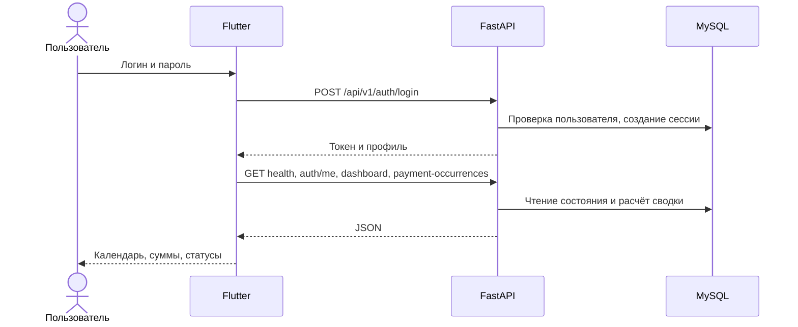

# Архитектура и модули

## Разделение ответственности

Решение состоит из двух репозиториев. `112233` — пользовательский интерфейс
Flutter/Dart. `invoice-keeper-backend` — HTTP API, расчёты, MySQL и Telegram-бот.
Клиент не является источником истины о правах, сроках или оплате: эти решения
проверяются сервером.

### Клиент

`main()` восстанавливает сессию и запускает `RitmApp`. Без сохранённого входа
открывается `RegistrationScreen` (несмотря на название класса, это форма входа).
После входа показывается `RitmDeviceShell`. При ширине до 500 логических пикселей
используется мобильная раскладка; на широком экране — ограниченная по размеру
оболочка приложения. Состояние главной хранится в `RitmController`, наследнике
`ChangeNotifier`; интерфейс реагирует через `ListenableBuilder`.

`RitmApiService` обрабатывает HTTP, токен, JSON и ошибки API. `AppConfig`
централизует адрес сервера. `RecurringPaymentsApi` обслуживает операции экрана
платежей. `ApiHistoryRepository` загружает историю с сервера;
`LocalHistoryRepository` работает с уже загруженным состоянием контроллера,
а не с отдельной офлайн-базой.

`RitmSession` хранит токен, профиль и имя пользователя через SharedPreferences.
В Web это хранилище браузера. Пароль может оставаться в памяти текущей вкладки
для повторного входа, но не сохраняется в SharedPreferences. В репозитории нет
необходимости хранить учётные данные для сборки сайта.

### Бэкенд

| Модуль | Что делает |
|---|---|
| `app/main.py` | Маршруты FastAPI, зависимости авторизации, жизненный цикл и запуск фоновых задач |
| `app/schemas.py` | Pydantic-схемы запросов/ответов и валидация |
| `app/services.py` | Платежи, периоды, сводки, пользователи, бюджеты, привязка Telegram |
| `app/database.py` | Пул MySQL, SQL-запросы, транзакции, проверка структуры базы |
| `app/security.py` | bcrypt, сессии, роли, синхронизация администратора и аудит |
| `app/config.py` | Настройки из окружения / `.env`, часовой пояс |
| `app/reminders.py` | Планировщик, Telegram HTTP-клиент, рассылка и polling |
| `app/bot.py` | `/start`, `/help`, `/status`, `/unlink`, тестовый `/link`, кнопки и события групп |
| `db/invoice_keeper_db.sql` | Начальная схема, SQL-функции, представления, триггеры и демо-данные |
| `db/migration_group_bot.sql` | Колонки привязки группы и таблица сообщений бота |

### Основные сущности MySQL

- `users` — пользователи и роли, привязка Telegram-группы.
- `user_sessions` — серверные сессии и срок их действия.
- `recurring_payments` — шаблоны регулярных расходов и якорный день месяца.
- `payment_occurrences` — отдельные периоды, плановый срок и фактическая оплата.
- `telegram_messages` — сообщения по периодам и чатам, чтобы обновлять их после оплаты.
- `system_settings` — часовой пояс и демонстрационная подмена даты.
- `budgets` — бюджеты по валютам; `audit_logs` — журнал действий.

Представления формируют подробный статус периода и сводки. `fn_today()` задаёт
единую дату для правил, а `fn_calc_monthly_due_date()` помогает вычислять месячный
срок. Приложение дополняет недостающие периоды. Триггеры защищают плановый срок
и согласованность фактической даты оплаты.

## Поток: вход и загрузка главной

## Поток: напоминание и отметка оплаты

1. Администратор создаёт регулярный платёж. API проверяет роль и данные.
2. Бизнес-логика создаёт период; планировщик далее достраивает будущие периоды.
3. Раз в заданный интервал (по умолчанию 60 секунд) планировщик выбирает периоды,
   которым требуется напоминание. Срок напоминания — не менее трёх дней.
4. Бронирование периода предотвращает повторную отправку обычным повторным циклом.
   После отправки сохраняются идентификаторы сообщений по чатам.
5. Нажатие «Оплачено» проверяется обработчиком бота: чат должен быть разрешён,
   период должен существовать, повторная оплата не создаётся.
6. Статус сохраняется в MySQL, сообщения обновляются, действие попадает в аудит.
7. После обновления сайта пользователь видит тот же статус из общего API.

## Правила, важные для защиты

Якорный день не должен «сползать»: после короткого февраля снова используется
исходный день. Просрочка наступает после планового срока; неоплаченный прошлый
период не мешает созданию следующего. Фактическую дату можно исправить,
плановый срок периода не меняется. Прекращение регулярного платежа сохраняет
историю. Разные валюты не складываются в один бессмысленный общий итог.

## Развёртывание

Nginx хоста отдаёт release-сборку Web и проксирует `/api/` к `127.0.0.1:8000`.
На текущем Aeza VPS API-контейнер использует сеть хоста, потому что доступ к
Telegram работает через IPv6 хоста. MySQL остаётся в Docker, её том хранит данные
между пересозданиями контейнеров. `restart: unless-stopped` восстанавливает
контейнер после сбоя и загрузки Docker.

Порт 8000 также оставлен доступным для ранее подключённых клиентов. Новый сайт
обращается через Nginx на том же origin, поэтому ему не требуется отдельное
CORS-разрешение для другого хоста/порта.

## Компромиссы прототипа

UI и сетевые классы пока объединены в крупных файлах; следующий шаг — вынести
API-клиент, модели, состояние и виджеты в отдельные каталоги. Синхронный драйвер
MySQL и планировщик в процессе API подходят для текущего демонстрационного
развёртывания, но требуют отдельного проектирования при росте нагрузки.
Нельзя называть текущую систему кластерной, отказоустойчивой или банковской.
