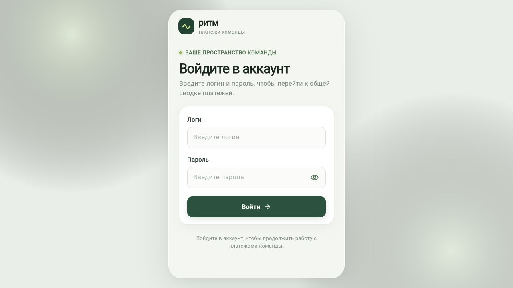
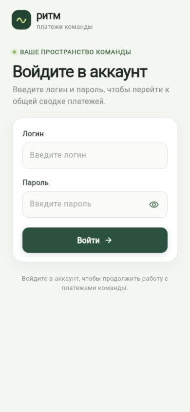

# Проверка поставки — 25 октября 2026

## Окружение

- Flutter **3.47.8 stable**, Dart **3.13.7**.
- Web release: JavaScript + локальный CanvasKit, без внешнего CDN движка.
- Сервер: Ubuntu 20.04, Nginx 1.18, Docker; FastAPI/Python 3.12 и MySQL 8.
- API и сайт связаны через Nginx `/api/`, исходный порт 8000 сохранён.

## Автоматические проверки клиента

`flutter test` — **5 тестов, все успешно**:

1. Экран входа при размере 320 × 640 без переполнения.
2. Экран входа при размере 390 × 844 без переполнения.
3. Экран входа при размере 1280 × 800 без переполнения.
4. Отсутствие скрытого входа администратором, когда нет учётных данных.
5. Пароль не сохраняется в SharedPreferences; старое значение удаляется.

Исправлено обнаруженное тестом переполнение заголовка на узком экране.
Шаблонный тест счётчика заменён тестами реального приложения.

`flutter analyze --no-pub` — **No issues found**. Анализ выполнялся на копии
тех же исходников в каталоге с ASCII-именем: анализатор этого SDK аварийно
обрабатывал исходный путь с кириллицей. Это ограничение инструмента, а не
успешный результат пропущенной проверки.

`flutter build web --release --no-web-resources-cdn` — **сборка успешна**.

## Проверки размещения

- `nginx -t` — конфигурация корректна.
- Главная и `main.dart.js` доступны с внешнего компьютера.
- CanvasKit отдается с обязательным `Content-Type: application/wasm`.
- `GET /api/v1/health` через публичный сайт: `status=ok`, `database=ok`.
- `GET /api/v1/users` без сессии: **401**.
- Вход администратора через Nginx и чтение `auth/me`, `dashboard`,
  `payment-occurrences`, `recurring-payments`, `payments/summary`, `users` — успешно.
- Тестовая сессия после проверки завершена через `auth/logout`.

## Проверки бэкенда из предыдущего этапа

Серверный репозиторий содержит **92 unit-теста**, прошедших в Docker.
На отдельной локальной MySQL до переноса выполнены 27 API-проверок и
15 сценариев бота с подменённым Telegram-транспортом. На сервере проверены
перезапуск контейнера, healthcheck и реальная отправка напоминания в привязанную
группу. Это разные виды проверок: транспортная имитация не считается отправкой.

## Что не проверялось

Физические устройства всех моделей, все браузеры, нагрузочный тест, банковские
операции, HTTPS и нативные Android/iOS-сборки. Размеры экранов проверены
автоматически; это не сертификат совместимости с любым устройством.

## Резервная копия и откат

Исходные конфиг Nginx и содержимое `/var/www/html` сохранены на сервере в
`/root/ritm-web-backups/20261024T230456Z/` (имя каталога — время UTC).
Релизы Web лежат в `/var/www/ritm/releases/`; активный выбирает симлинк
`/var/www/ritm/current`. База и бот при обновлении статического сайта не меняются.

## Визуальная проверка опубликованного сайта

Проверена реальная отрисовка экрана входа в браузере на настольной ширине
и в viewport 390 × 844. Неверный MIME-тип WebAssembly в Nginx исправлен;
повторная загрузка движка работает. Снимки сделаны с размещённого сайта:

